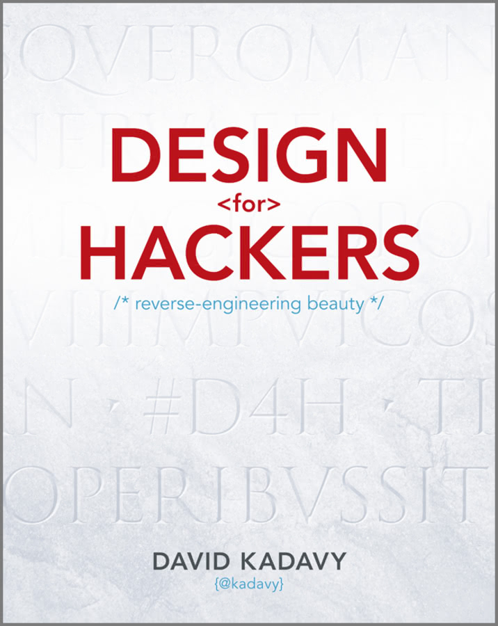
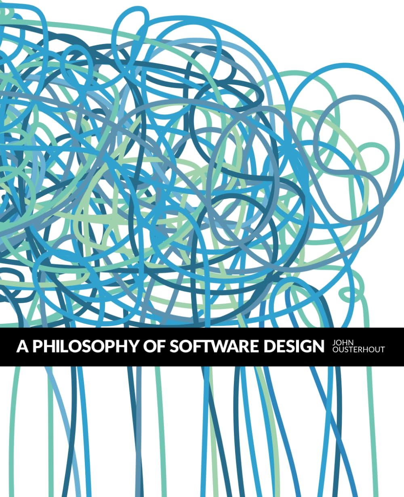

# 软件工程与设计电子书

五本简体中文 EPUB，可下载后导入 Apple 图书、Calibre 等支持 EPUB 的阅读器。

| 封面 | 中文书名 | 英文书名 | 作者 | 下载 |
| --- | --- | --- | --- | --- |
|  | 《软件工程手册》 | The Software Engineering Handbook: A Judgment and Decision-Making Approach | James C. Davis | [下载 EPUB](https://raw.githubusercontent.com/wangruofeng/design-engineering-epubs/main/books/software-engineering-handbook-zh-cn.epub) |
|  | 《写给程序员的设计书》 | Design for Hackers: Reverse Engineering Beauty | David Kadavy | [下载 EPUB](https://raw.githubusercontent.com/wangruofeng/design-engineering-epubs/main/books/design-for-hackers-zh-cn.epub) |
|  | 《写给大家看的设计书》 | The Non-Designer’s Design Book | Robin Williams | [下载 EPUB](https://raw.githubusercontent.com/wangruofeng/design-engineering-epubs/main/books/the-non-designers-design-book-zh-cn.epub) |
|  | 《重构 UI》 | Refactoring UI | Adam Wathan、Steve Schoger | [下载 EPUB](https://raw.githubusercontent.com/wangruofeng/design-engineering-epubs/main/books/refactoring-ui-zh-cn.epub) |
|  | 《软件设计的哲学（第二版）》 | A Philosophy of Software Design, 2nd Edition | John Ousterhout | [下载 EPUB](https://raw.githubusercontent.com/wangruofeng/design-engineering-epubs/main/books/a-philosophy-of-software-design-2e-zh-cn.epub) |

## 版权说明

这些书籍收集于互联网，版权归于原作者。

《软件设计的哲学（第二版）》采用 [Gang Yin（yingang）及贡献者的简体中文译本](https://github.com/yingang/aposd2e-zh/tree/4362314d5bb8eedbe2a088f950850a187b3f8641)，译本项目标注 [CC BY 4.0](https://creativecommons.org/licenses/by/4.0/)。EPUB 整理调整了版式与内部链接。封面取自[作者书籍主页](https://web.stanford.edu/~ouster/cgi-bin/aposd.php)链接的[英文第二版商品页](https://www.amazon.com/dp/173210221X)。
